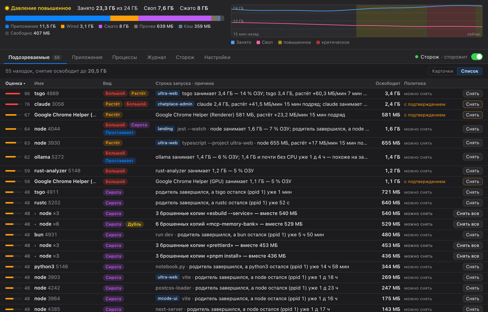
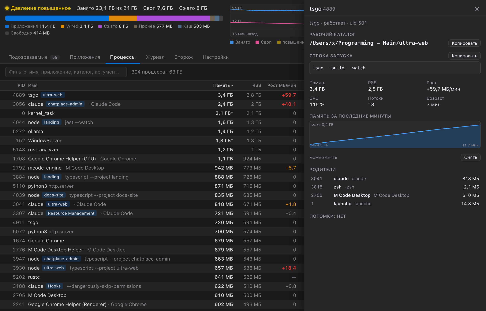
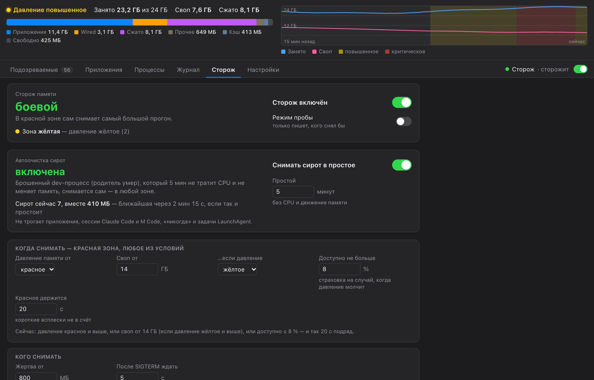
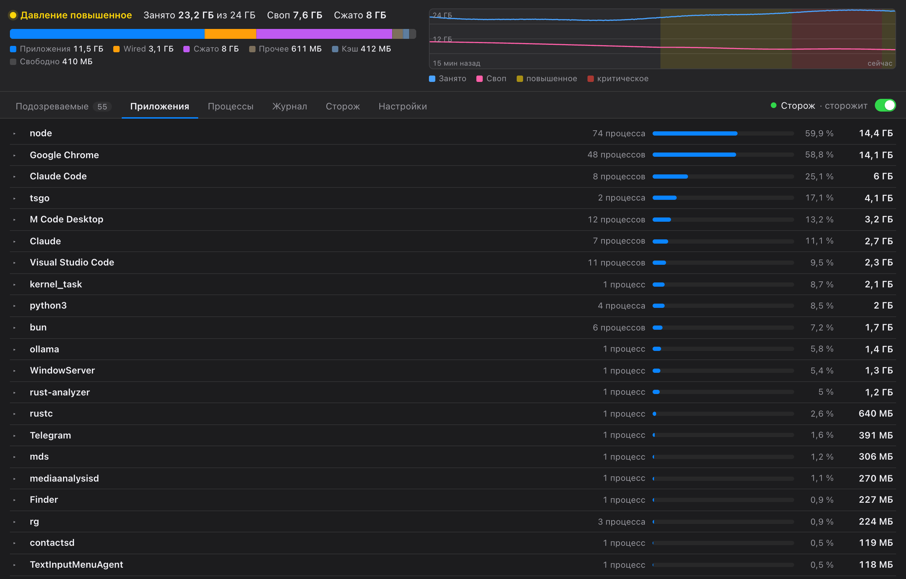

# Resource Management

**Resource Monitor** is a lightweight macOS memory monitor for people who run a lot of dev tooling
and AI agents at once. Activity Monitor shows the numbers. Resource Monitor answers the questions
behind them: **who is eating memory, is it still growing, is it still needed, and is it safe to kill?**

It also ships a **memory guard** that steps in when the Mac runs low on memory. It also cleans up
orphaned dev processes that sit idle. Both act through the same safety layer, so your apps and
system processes are never touched.

> **Status:** macOS 13+. The interface is in Russian for now.
> Linux and Windows are planned (see [ROADMAP](docs/ROADMAP.md)).



## Features

- **Suspects.** Processes that are big, growing, orphaned (parent died), idle, or abandoned
  duplicates. Each comes with a score, a plain-language reason, how much it would free, and whether
  it is safe to kill.
- **Real memory numbers.** Memory pressure and its 15-minute history, plus a breakdown into app,
  wired, compressed, cache and free, and swap. The totals match Activity Monitor.
- **Apps and processes.** Helpers are grouped under their app. For `claude`, `node`, `tsgo` and
  similar processes the project they run in is shown. Filter by name, path or command line.
- **Process details.** Full command line, working directory, parent chain, children, and a memory
  graph.
- **Memory guard.**
  - When memory pressure stays red, the guard kills the largest build or test run (`tsgo`, `tsc`,
    `vitest`, `jest`, `node`, `bun`), names the project and session that started it, and sends a
    notification.
  - **Orphan auto-cleanup**, on by default: an orphaned dev process that has used no CPU and kept
    the same memory for N minutes (default 5) is killed in any zone.
  - Rate limits, a dry-run mode, and a per-kill journal.
- **Menu bar icon.** It shows pressure as a color plus memory used, and has a guard toggle.
  The app starts at login.
- **Safety layer.** Before every kill it checks that the PID still belongs to the same process.
  It sends SIGTERM, waits, then SIGKILL. System processes are never touched. Your apps (browsers,
  editors, Claude, Telegram…) need explicit confirmation. Every action is logged.
- **CLI `rmon`.** Commands: `status`, `ps`, `suggest`, `why <pid>`, `kill <pid>`, `guard …`,
  `config`. All of them support `--json`.
- **MCP server for Claude Code.** Run `rmon mcp` and Claude can inspect memory and clean up through
  the same safety layer. It asks you before touching your apps. See [docs/CLAUDE_CODE.md](docs/CLAUDE_CODE.md).

| Process details | Memory guard |
|---|---|
|  |  |



## Install (macOS)

Requirements: Rust (stable, 1.89+), Node.js 22+, Xcode Command Line Tools.

```bash
git clone https://github.com/leoerdman/Resource-Management.git
cd Resource-Management
scripts/install-macos.sh          # add --dmg to also build a .dmg installer
```

This builds the app, installs it to `/Applications/Resource Monitor.app`, and links the CLI to
`~/.local/bin/rmon`. The build is signed ad hoc, without a Developer ID.

Connect to Claude Code:

```bash
claude mcp add --scope user rmon -- "/Applications/Resource Monitor.app/Contents/MacOS/rmon" mcp
```

## Configuration

All settings can be changed in the app and are saved to `~/.config/rmon/config.toml` (your comments
in that file are kept). The guard's allow and never lists, the kill policy and the thresholds can
also be edited there. Run `rmon config` to show the file, the log paths, and any rule errors.

```toml
[guard]
enabled = true
dry_run = false

[guard.orphans]      # orphan auto-cleanup
enabled = true
idle_mins = 5
```

Logs (JSONL, kept for 24 h) live in `~/Library/Logs/rmon/`: `actions.jsonl` records kills and
refusals, `guard.jsonl` records guard decisions, and `timeline.jsonl` records a state snapshot
every minute.

## Development

```bash
cargo test --workspace            # also regenerates TS types in apps/rmon-app/src/bindings
cd apps/rmon-app && npm ci && npm test
npm run dev                       # UI in a browser with a mock backend (demo data)
npx tauri dev                     # the real app
```

Layout: `crates/rmon-core` holds collection, analysis, kill policy and the guard. `crates/rmon-cli`
is the CLI, `crates/rmon-mcp` is the MCP server, and `apps/rmon-app` is the Tauri 2 + React app.
The design and its decisions are in [docs/SPEC.md](docs/SPEC.md).

## License

[MIT](LICENSE)

---

## По-русски

**Resource Monitor** — лёгкий монитор памяти для macOS. Он отвечает на вопросы, на которые не
отвечает Activity Monitor: кто съел память, растёт ли он, нужен ли он ещё и можно ли его снять
безопасно.

- В окне вкладки «Подозреваемые», «Приложения», «Процессы», «Журнал», «Сторож» и «Настройки».
  В строке меню — значок, окрашенный по давлению памяти.
- **Сторож памяти.** В красной зоне он сам снимает самый большой прогон сборки или тестов.
  **Автоочистка сирот** (включена по умолчанию) снимает брошенный dev-процесс, если тот N минут
  не тратит CPU и не меняет память.
- Все снятия проходят через защитный слой. Системные процессы защищены, ваши приложения — только с
  подтверждением, каждое действие пишется в журнал.
- Есть CLI `rmon` и MCP-сервер для Claude Code.

Установка: `scripts/install-macos.sh`. Пока только macOS 13+, Linux и Windows — в планах.
